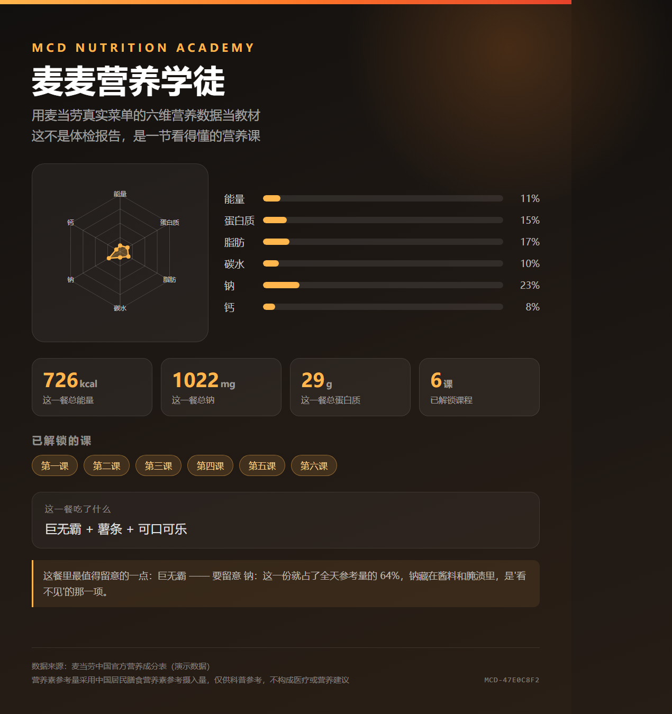
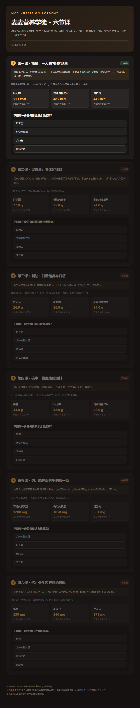

# 麦麦营养学徒 · MCD Nutrition Academy

> 用麦当劳真实菜单的六维营养数据当教材，做成六节能闯关的营养课，最后给你一张可以发朋友圈的结业证。

[](LICENSE)
[](https://github.com/M-China/mcd-mcp-server)
[](https://github.com/M-China/mcd-developer-innovation-challenge)

---

## 一句话说清它是什么

麦当劳官方营养计算器给你六列数字（能量、蛋白质、脂肪、碳水、钠、钙），没人看得懂。
本项目把这六列数据做成**六节课**——每课讲透一个营养素，配一道**从真实数据里自动生成**的题，答对解锁下一课，六课通关拿到一张六轴雷达图结业证。

**它不是一个卡路里计算器，是一门用你天天在吃的菜单当教材的营养课。**

## 为什么做成"课"而不是"报告"

市面上的营养类工具基本在做同一件事：算出你吃了多少卡路里，然后提醒你少吃。这条路对成年人都不太管用，对孩子更没意义——因为**数字本身不产生理解，理解才产生改变**。

所以这里的关键设计是：**每节课都必须答对一道题才能解锁下一课**。题目不是提前写死的文案，而是运行时从 MCP 拉到的真实营养表里推导出来的——"下面哪一份的钠含量最高？"，四个选项都是真餐品，正确答案由数据算出。数据更新，题目自动跟着变，讲义和数据永远不会对不上。

学完你会得到一个具体的判断力：看一眼营养标签，**知道自己一天该分掉多少给蛋白质、哪一项要留点余地给钠**。



## 六节课

| 课 | 主题 | 教学落点 |
|---|---|---|
| 第一课 | **能量** | 一天的"电费"账单，这一餐占全天多少 |
| 第二课 | **蛋白质** | 身体的建材——看它占总能量的比例，比只看克数更有意义 |
| 第三课 | **脂肪** | 能量储备与口感来源，脂肪供能占比 |
| 第四课 | **碳水** | 最直接的燃料，也是甜饮里最容易忽略的那部分 |
| 第五课 | **钠** | 藏在酱料、腌渍和面包里，吃的时候尝不出来 |
| 第六课 | **钙** | 骨头和牙齿的原料，常见餐品里最缺位的一项 |



## 快速开始

### 环境要求

- Python 3.8+（无第三方依赖，标准库即可运行）
- Node.js + Playwright（**可选**，仅用于把结业证导出成 PNG 图片）
- 麦当劳 MCP Token（**可选**，没有也能跑演示模式）

### 三步跑起来

```bash
# 1) 拿 Token：https://open.mcd.cn 用手机号登录 → 控制台 → 激活 → 复制 Token
export MCD_MCP_TOKEN=你的Token

# 2) 采集营养数据（真实数据）
python3 scripts/collect.py

#    没有 Token 也能跑，用麦当劳中国官方营养成分表作为离线数据：
#    python3 scripts/collect.py --demo

# 3) 生成课程页与结业证
python3 scripts/build_course.py
```

产物在 `out/`：

| 文件 | 说明 |
|---|---|
| `out/lesson.html` | 六节可闯关的课程页，单文件，直接用浏览器打开 |
| `out/certificate.html` | 结业证（含六轴雷达图），单文件 |
| `out/certificate.png` | 结业证图片（需要 Playwright） |

### 导出图片

```bash
node scripts/render_png.js out/certificate.html out/certificate.png 1080 1350
```

### 在 WorkBuddy 里使用

本项目同时是一个 WorkBuddy Skill。安装后直接说：

- "来一节麦麦营养课"
- "生成我的麦麦营养结业证"
- "看看这顿的六维营养雷达"

WorkBuddy 会自动调用麦当劳 MCP 取数、生成课程与结业证。

## 它到底用了麦当劳 MCP 的什么

只调用**只读** Tool，不下单、不消耗积分、不抽奖。

| Tool | 用途 |
|---|---|
| `list-nutrition-foods` | 核心数据源：全量餐品六维营养成分表，课程题目与结业证数字全部由它推导 |
| `order-list` | 用户历史订单（可选，用于关联"我常点的餐"） |
| `query-my-account` | 会员积分（可选） |

详细说明见 [MCP_INTEGRATION.md](MCP_INTEGRATION.md)。

## 项目结构

```
mcd-nutrition-academy/
├── SKILL.md                  # WorkBuddy Skill 定义
├── README.md                 # 本文件
├── CONTEST_DECLARATION.md    # 参赛声明（官方原文）
├── MCP_INTEGRATION.md        # MCP Server / Tool / 调用流程 / 业务价值
├── mcp-config.example.json   # 脱敏配置示例（仅环境变量占位符）
├── workbuddy.md              # WorkBuddy 开发对话上下文
├── PROMO.md                  # 传播素材与发帖文案
├── scripts/
│   ├── mcp_client.py         # MCP Streamable HTTP 客户端（零依赖）
│   ├── collect.py            # 采集与归一化
│   ├── nutrition_kb.py       # 营养知识库 / 参考量 / 雷达计算
│   ├── build_course.py       # 课程与结业证渲染
│   └── render_png.js         # Playwright 截图（可选）
├── data/
│   └── nutrition_demo.json   # 离线演示数据（官方营养成分表）
├── references/
│   ├── mcp_tools.md          # MCP tool 清单与实测返回结构
│   └── compliance.md         # 合规红线与措辞规范
└── assets/                   # README 引用的图片
```

## 目标用户

**想看懂营养标签的普通人**，尤其是两类：

- **给孩子买饭的家长**——想知道一顿麦当劳里钠和钙分别占多少，好和当天的其他两餐搭配着看；
- **刚开始关注饮食的上班族**——需要的不是"你超标了"的警告，而是"钠藏在酱料里"这种能迁移到超市货架的知识。

教育机构、营养科普博主也可以直接拿去当课件。

## 数据口径与免责声明

- 营养数据来自麦当劳 MCP `list-nutrition-foods`；演示模式使用麦当劳中国官方营养成分表（数据更新时间 2025 年 4 月），**均以单份餐品计量**。
- 营养素参考摄入量采用《中国居民膳食营养素参考摄入量》成人 18-49 岁轻体力活动水平。
- 所有百分比以**全天参考摄入量**为分母。
- 本项目输出**仅供营养科普参考，不构成医疗、营养或其他专业建议**。
- 餐品信息、价格及供应状态以麦当劳官方渠道的实时结果为准。
- 本项目为参赛作品，非麦当劳官方产品。

## License

MIT，见 [LICENSE](LICENSE)。
